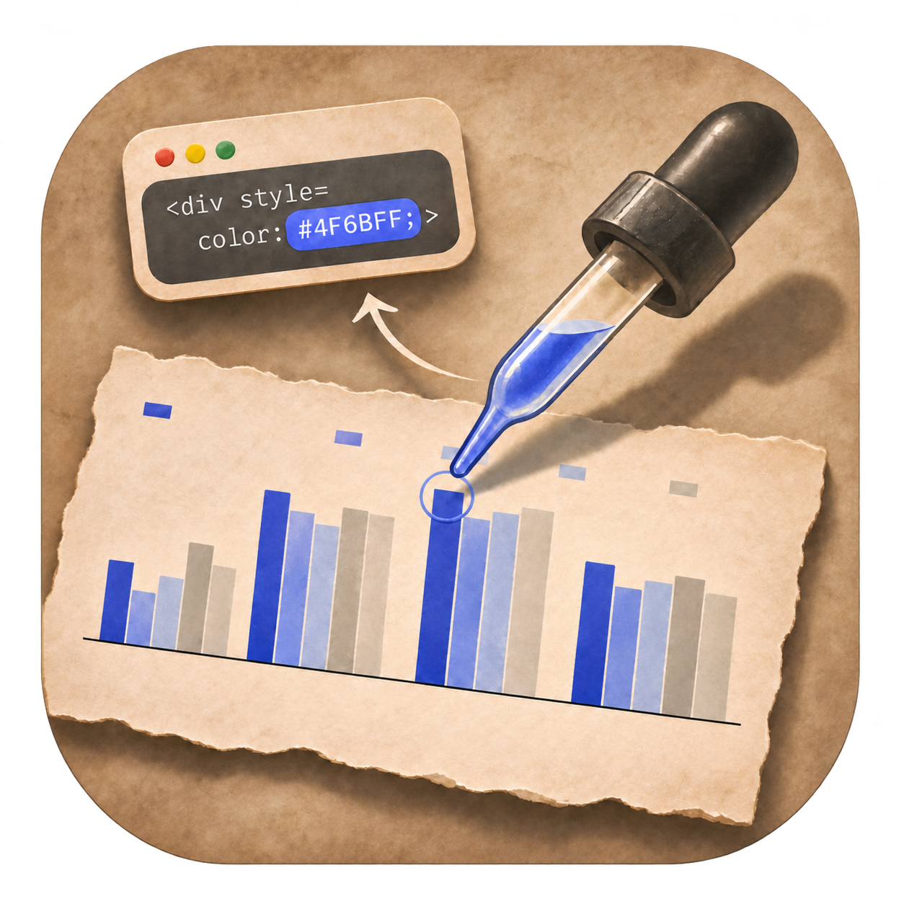

<p align="center">
  
</p>

<h1 align="center">PixelDrop</h1>

<p align="center">Pick a screen color. Copy its HTML hex code.</p>

PixelDrop is a small color picker for **macOS** and **Ubuntu** (Not supporting Windows because I hate this OS). On macOS it lives in the menu bar, without a Dock icon. Press **⌘⇧2**, move the eyedropper, and click to copy a color such as `#12ABEF`. A popup confirms the copied code.

## Features

- System eyedropper on macOS, with a magnifier and Escape cancellation.
- Copies uppercase `#RRGGBB` colors and shows a three-second confirmation popup.
- Menu bar controls, global macOS shortcut, and no Dock icon.
- Optional frozen screenshot mode on macOS.
- Ubuntu screenshot picker using X11 or the Wayland Screenshot portal.
- Local processing: no accounts, uploads, or analytics.

## Install

### macOS 14 or later

Download `PixelDrop-macos-universal.dmg` from this repository's **Releases**, then:

1. Open the DMG and drag **PixelDrop.app** into **Applications**.
2. Eject the DMG and open PixelDrop from Applications.
3. Find PixelDrop in the menu bar. Use its menu to quit.

The universal app supports Apple Silicon and Intel Macs. Current builds are ad-hoc signed and are **not Apple notarized**, so macOS may show a security warning for downloaded builds. Public signing and notarization require the maintainer's Apple Developer credentials.

### Ubuntu desktop

Install the desktop dependencies:

```sh
sudo apt update
sudo apt install python3 python3-gi python3-gi-cairo gir1.2-gtk-3.0 xdg-desktop-portal
```

Run from source:

```sh
/usr/bin/python3 linux/pixeldrop.py
```

On Wayland, your desktop must provide a Screenshot-capable portal backend. Ubuntu GNOME normally supplies it. The desktop may request authorization for screenshots.

### curl / wget

Use the installer with this repository's `AbnerTeng/PixelDrop`:

```sh
curl -fL https://github.com/AbnerTeng/PixelDrop/releases/latest/download/install.sh -o /tmp/pixeldrop-install.sh
sh /tmp/pixeldrop-install.sh AbnerTeng/PixelDrop
```

Or download the same script with `wget`:

```sh
wget https://github.com/AbnerTeng/PixelDrop/releases/latest/download/install.sh -O /tmp/pixeldrop-install.sh
sh /tmp/pixeldrop-install.sh AbnerTeng/PixelDrop
```

The installer verifies release SHA-256 checksums. It installs macOS to `~/Applications`, or Ubuntu to `~/.local/share/pixeldrop` with a launcher in `~/.local/bin` and an Applications entry. Ubuntu dependencies must be installed first. An optional second argument selects a release tag, for example `v0.1.8`.

### Homebrew

Homebrew packaging is prepared; a tap has not been published. Releases generate a formula and a cask. After the maintainer adds the cask to `OWNER/homebrew-tap/Casks/pixeldrop.rb`, install with:

```sh
brew install --cask OWNER/tap/pixeldrop
```

## Use

| Action | macOS | Ubuntu |
| --- | --- | --- |
| Start picking | **⌘⇧2**, **Pick a color**, or the menu bar | Launch PixelDrop |
| Copy a color | Click | Click |
| Cancel | **Esc** | **Esc** or right-click |
| Confirm copying | Popup and menu bar hex code | Popup and terminal output |

On Ubuntu, assign `~/.local/bin/pixeldrop` to a custom shortcut in **Settings → Keyboard** after installation. The installer does not change your keyboard shortcuts.

The normal macOS picker uses Apple's `NSColorSampler` on the live screen. It does not use the app's ScreenCaptureKit permission flow. For a frozen image, choose **Freeze screenshot and pick…** in the menu; this optional mode requires **Screen Recording** permission. Denying frozen capture does not block the normal eyedropper.

Ubuntu shows the captured desktop in a fullscreen picker. On multiple monitors, it presents the full screenshot as an overview on one display while sampling original pixels. macOS frozen mode uses an overlay on each display.

macOS converts colors to sRGB; Ubuntu reads the screenshot's RGB bytes. Display profiles, HDR, transparency, and app effects can make captured colors differ from the original document's authored color values. Screenshots stay local; the Ubuntu portal may supply a desktop-managed temporary image.

## Build

macOS requires Apple's command line developer tools and Python 3:

```sh
./scripts/build.sh
open dist/PixelDrop.app
```

Quit an existing PixelDrop instance before rebuilding. For a universal app and DMG:

```sh
ARCHS='arm64 x86_64' ./scripts/build.sh
./scripts/package.sh
```

Artifacts are written to `dist/release/`; they are excluded from Git. The DMG contains PixelDrop and an Applications shortcut for drag-and-drop installation.

### Change the icon

Replace `assets/PixelDrop.png` with a square PNG, ideally with a transparent background, and rebuild. The build generates standard and Retina ICNS representations, embeds the icon, and signs the bundle. Ubuntu uses the same source PNG.

## Checks

```sh
# macOS: tests the picker flow with injected system callbacks, without GUI access
./scripts/test-flow.sh

# macOS: actual panels and Escape event delivery; requires a logged-in desktop
./scripts/test-macos.sh

# Ubuntu: pixel sampling and Escape before clicking
sudo apt install xvfb
xvfb-run -a /usr/bin/python3 -m unittest discover -s tests -v
```

Flow tests simulate selection, cancellation, denied-capture recovery, and pending capture cancellation. They do not prove that desktop permissions or GUI rendering work on every machine. Ubuntu tests also run in release CI.

## Release

Push a semantic version tag such as `v0.1.8`. The GitHub Actions workflow builds both platforms, runs tests, and publishes:

- Universal macOS DMG and application archive.
- Ubuntu archive.
- Download installer and `SHA256SUMS`.
- Homebrew formula (`pixeldrop.rb`) and cask (`pixeldrop-cask.rb`).

To generate tap files locally alongside release packages:

```sh
./scripts/package.sh AbnerTeng/PixelDrop v0.1.8
```

For Developer ID signing, set `CODE_SIGN_IDENTITY` when building and packaging. Set `NOTARY_PROFILE` to an existing `notarytool` keychain profile during packaging to submit and staple the DMG. Credentials are never stored in this repository.

## Project layout

```text
Sources/main.swift          Native macOS app
linux/pixeldrop.py           Ubuntu GTK picker
assets/PixelDrop.png         Shared app icon
scripts/                    Build, packaging, and checks
install.sh                  Release download installer
.github/workflows/          Release automation
```
